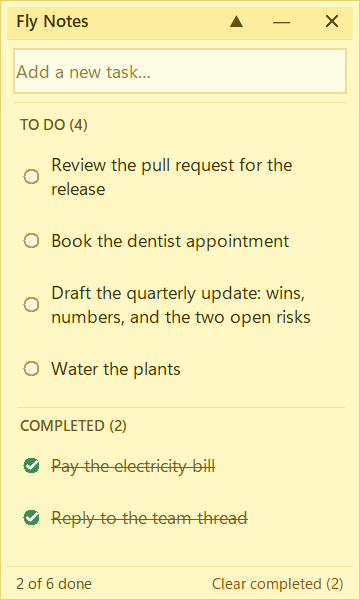
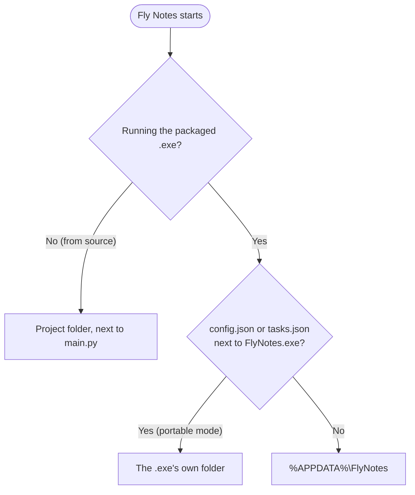
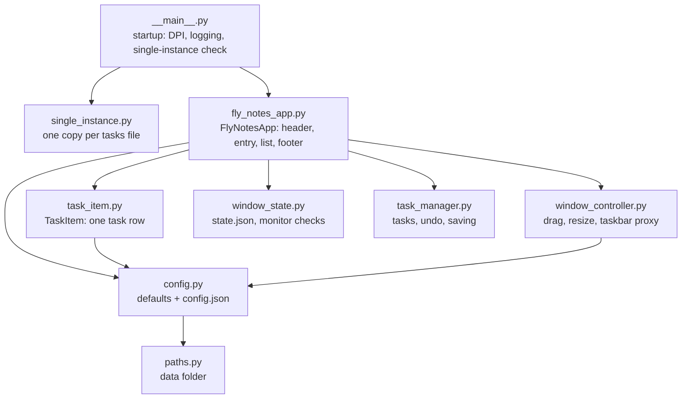
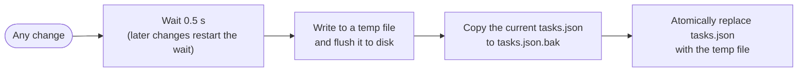
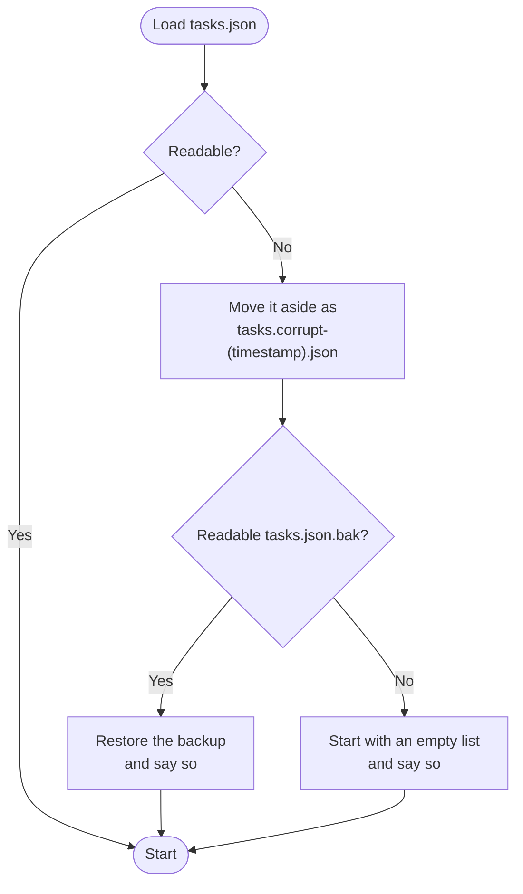
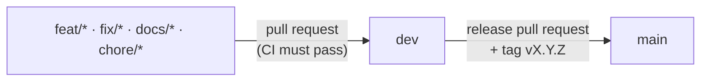

# Fly Notes

[](https://github.com/dbarretol/fly-notes/actions/workflows/ci.yml)
[](https://github.com/dbarretol/fly-notes/releases/latest)


[](LICENSE)

**A small floating to-do list for Windows that stays out of your way.**

Fly Notes is a borderless task widget that sits on top of your other windows. It fades when you
are working elsewhere and keeps your list in a plain local JSON file, with no account, no cloud
and no telemetry. It is written in Python with Tkinter, with no third-party runtime
dependencies, and ships as a single `.exe`.

<p align="center">
  
</p>

## Contents

- [Features](#features)
- [Getting started](#getting-started)
- [Using Fly Notes](#using-fly-notes)
- [Configuration](#configuration)
- [Where your data lives](#where-your-data-lives)
- [How it works](#how-it-works)
- [Development](#development)
- [Platform notes and limitations](#platform-notes-and-limitations)
- [Roadmap and changelog](#roadmap-and-changelog)
- [License](#license)

## Features

**A window that floats, not one that gets in the way**

- Borderless widget that stays **always on top** by default. The header pin (`▲`/`△`) or
  `Ctrl+T` turns this off and on, and the choice is remembered.
- **Fades** to a translucent state shortly after it loses focus, and comes back fully opaque
  when you return.
- Move it by dragging the header, and **resize it from any edge or corner**.
- **Remembers its size and position** between sessions. If that spot is no longer on a
  connected monitor (say, after undocking a laptop), it opens at the default position.
- Minimizes to and restores from the **Windows taskbar**, even though the window has no
  native frame.
- **Single instance**: launching it again brings the open window to the front instead of
  starting a second copy that would overwrite the same tasks.

**Tasks**

- Type and press `Enter` to add a task. Long tasks wrap onto several lines.
- Tick the checkbox to complete a task. Completed tasks move to their own **Completed**
  section, struck through.
- **Edit in place** by double-clicking a task (or pressing `F2`).
- **Reorder** by dragging a task, or with `Alt+↑` / `Alt+↓`.
- Delete one task, or **clear all completed** ones at once. Both can be **undone**, from the
  footer's "Undo" link or with `Ctrl+Z`, and tasks come back at their original position.
- Very long lists render a page at a time, with a **"Show N more"** link.
- **Fully usable from the keyboard** (see [Keyboard shortcuts](#keyboard-shortcuts)).

**Your data is safe and yours**

- Saved automatically to a local `tasks.json`. Writes are atomic, so a crash or power cut
  mid-save can't leave a half-written file.
- The previous version is kept as `tasks.json.bak`. A file that can't be read is set aside,
  never overwritten, and the backup is restored automatically.

**Configurable**

- Colors, transparency, spacing, fonts, shortcuts, behavior and every UI string can be
  overridden with an optional `config.json`.

## Getting started

### Option A: download the executable (no Python needed)

1. Download `FlyNotes.exe` from the
   [latest release](https://github.com/dbarretol/fly-notes/releases/latest).
2. Run it. There is nothing to install.

> [!NOTE]
> The executable is not code-signed, so Windows SmartScreen may show a warning the first time.
> Choose **More info → Run anyway**, or run from source (option B) or
> [build the `.exe` yourself](#building-the-exe).

### Option B: run from source

Requires **Windows 11**, **Python 3.12+** (Tkinter is included in the standard Windows
installer) and, ideally, [uv](https://docs.astral.sh/uv/).

```powershell
git clone https://github.com/dbarretol/fly-notes.git
cd fly-notes
uv sync
uv run fly-notes          # or: uv run main.py
```

Without uv:

```powershell
python -m venv .venv
.venv\Scripts\activate
pip install -e .
fly-notes                 # or: python -m fly_notes
```

## Using Fly Notes

| To… | Do this |
|---|---|
| Add a task | Type in the top field and press `Enter` |
| Complete / reopen a task | Click its checkbox (or focus it and press `Space`) |
| Edit a task | Double-click its text, or hover it and press `F2`. `Enter` saves, `Esc` cancels |
| Reorder | Drag the task's text, or focus it and press `Alt+↑` / `Alt+↓` |
| Delete a task | Hover it and click its delete button, or focus it and press `Delete` |
| Undo a delete or clear | Click **Undo** in the footer within a few seconds, or press `Ctrl+Z` later |
| Move / resize the window | Drag the header / drag any edge or corner |
| Keep it on top or not | Click the header pin (`▲` on top, `△` normal) or press `Ctrl+T` |
| Minimize / close | Use the `—` / `✕` buttons in the header (`Ctrl+W` closes) |

### Keyboard shortcuts

Anywhere in the window:

| Key | Action |
|---|---|
| `Ctrl+N` | Focus the new-task field |
| `Enter` | Add the typed task |
| `Esc` | Clear the new-task field (it never closes the app) |
| `F2` | Edit the task under the pointer, or the focused one |
| `Ctrl+D` | Clear completed tasks |
| `Ctrl+Z` | Undo the last deletion or clear (repeat to go further back) |
| `Ctrl+T` | Toggle always on top |
| `Ctrl+W` | Close Fly Notes |

On a focused task (reach the list with `Tab`, or `↓` from the new-task field; the focused
task shows a highlighted border):

| Key | Action |
|---|---|
| `↑` / `↓` | Previous / next task (`↑` on the first task returns to the new-task field) |
| `Space` | Mark complete / not complete |
| `Delete` | Delete the task (undo with `Ctrl+Z`) |
| `Alt+↑` / `Alt+↓` | Move the task up / down within its section |
| `F2` / `Enter` | Edit the task |

The window-wide shortcuts can be changed in the `shortcuts` section of `config.json`, using
Tk event syntax (for example `"close": "<Control-q>"`).

## Configuration

Fly Notes works out of the box. To customize it, create a `config.json` in the
[data folder](#where-your-data-lives) containing **only the keys you want to change**.
Everything else keeps its default.

Example: a green header and a larger default window.

```json
{
  "colors": {
    "header_bg": "#2D6A4F",
    "border_focus": "#2D6A4F"
  },
  "settings": {
    "default_width": 360,
    "default_height": 520
  }
}
```

| Section | What it controls | Examples of keys |
|---|---|---|
| `colors` | Every color in the UI | `header_bg`, `content_bg`, `border_focus`, `link_color` |
| `transparency` | Window opacity, `0.0`–`1.0` | `active` (focused, default `1.0`), `inactive` (default `0.75`) |
| `settings` | Sizes and behavior | `default_width`, `always_on_top`, `max_visible_tasks`, `undo_timeout_ms`, `group_completed`, `tasks_file` |
| `spacing` | Paddings and gaps | `sm`, `md`, `lg` |
| `fonts` | `[family, size, style…]` per text role | `body`, `header`, `section` |
| `shortcuts` | Window-wide key bindings (Tk syntax) | `new_task`, `undo`, `toggle_always_on_top`, `close` |
| `strings` | Every UI text, for rewording or translating | `entry_placeholder`, `empty_state`, `undo_action` |

The full list of keys and their defaults is `DEFAULT_CONFIG` in
[`fly_notes/config.py`](fly_notes/config.py).

A mistake can't break the app:

- Unknown keys are ignored, and a warning is logged.
- An invalid value, such as a malformed color, makes Fly Notes ignore the whole file and use
  the defaults.
- A color pair with poor contrast (below the WCAG ratio) only logs a warning.

## Where your data lives

All files sit together in one data folder:

- `tasks.json`: your tasks.
- `tasks.json.bak`: the previous save.
- `state.json`: window size, position and the always-on-top choice.
- `config.json`: optional, your overrides.



- **Portable use** (for example from a USB stick or a synced folder): put a `tasks.json`
  containing `[]` next to `FlyNotes.exe`.
- **Custom tasks file**: `settings.tasks_file` points the tasks file elsewhere. A relative
  path is taken from the data folder, and environment variables such as `%USERPROFILE%` are
  expanded. `state.json` and the backup follow the tasks file.
- **Reset the window**: delete `state.json` to return to the default size, position and
  always-on-top setting.

## How it works

### Architecture



- `FlyNotesApp` owns the UI and connects it to `TaskManager`, which holds the task list.
- `task_manager.py`, `window_state.py`, `single_instance.py` and `paths.py` don't use
  Tkinter, so they can be tested without a window.

### Saving and recovery

Every change schedules a save half a second later, so a burst of edits becomes one write.
Closing the app saves immediately.



On startup, a `tasks.json` that can't be read is never overwritten:



Individual malformed tasks are skipped, and a copy of the original file is kept. If the
unreadable file can't even be moved aside, saving is turned off for that session, so nothing
can overwrite it.

### Borderless window on Windows

The window is drawn without the native frame (Tk's `overrideredirect`). On Windows, that also
removes it from the taskbar. Fly Notes therefore keeps a hidden, normal "proxy" window that
holds the taskbar button:

- **Minimize** hides the main window and minimizes the proxy.
- **Clicking the taskbar button** restores the proxy, which brings the main window back.

## Development

```powershell
uv sync --extra dev                  # pytest, pytest-cov, ruff, pyinstaller
uv run pytest                        # test suite
uv run pytest --cov=fly_notes --cov-report=term-missing
uv run ruff check .                  # lint
uv run ruff format .                 # format
```

Project layout:

```
fly-notes/
├── main.py                    # Thin launcher (also the PyInstaller entry script)
├── fly_notes/
│   ├── __main__.py            # Startup: DPI awareness, logging, single-instance check, Tk root
│   ├── fly_notes_app.py       # Main window: header, entry, task list, footer
│   ├── task_item.py           # One task row + custom checkbox
│   ├── task_manager.py        # Tasks, undo, debounced atomic saving (no Tkinter)
│   ├── window_controller.py   # Borderless drag/resize + taskbar proxy
│   ├── window_state.py        # state.json: geometry, always on top, monitor checks
│   ├── single_instance.py     # One running copy per tasks file (Windows named mutex)
│   ├── config.py              # Defaults, validation, config.json merging
│   └── paths.py               # Where the data folder is
├── tests/                     # pytest suite
├── assets/                    # Window icon
├── docs/images/               # README screenshot
├── AGENTS.md                  # Notes for coding agents and contributors
├── .github/                   # CI workflow and pull request template
├── FlyNotes.spec              # PyInstaller build spec
├── CHANGELOG.md
├── LICENSE
└── pyproject.toml
```

### Branches and pull requests



- Work happens on short-lived branches, opened as pull requests against `dev`.
- `main` only receives releases from `dev`.
- GitHub Actions ([`ci.yml`](.github/workflows/ci.yml)) runs ruff on Ubuntu and the test
  suite on Windows for every pull request and push to `dev` and `main`.
- User-visible changes go in the `[Unreleased]` section of [CHANGELOG.md](CHANGELOG.md).

### Building the .exe

```powershell
uv run pyinstaller FlyNotes.spec --clean
```

The output is `dist/FlyNotes.exe`, a PyInstaller *onefile* build. It unpacks itself to a
temporary folder on every launch, which is why it keeps its data in `%APPDATA%\FlyNotes` (or
next to the `.exe` in portable mode), never in that temporary folder.

## Platform notes and limitations

- **Windows only, by design.** The borderless window, the taskbar proxy and the
  single-instance check all rely on Windows behavior. The `.exe` runs only on Windows.
- **macOS and Linux are unsupported and untested.** The app starts, with a warning in the log,
  but:
  - the window may lose its dock or taskbar entry, with no way to restore it after minimizing;
  - transparency depends on the window manager;
  - a second copy is not prevented.

  The task list, dragging and resizing are plain Tk and should still work.
- Tasks are stored locally only. There is no sync between machines, although a synced folder
  in [portable mode](#where-your-data-lives) can be used for that.

## Roadmap and changelog

- Planned work is tracked in [issues](https://github.com/dbarretol/fly-notes/issues) and grouped
  by [milestone](https://github.com/dbarretol/fly-notes/milestones).
- Changes in each release are listed in [CHANGELOG.md](CHANGELOG.md).

## License

[MIT](LICENSE)
